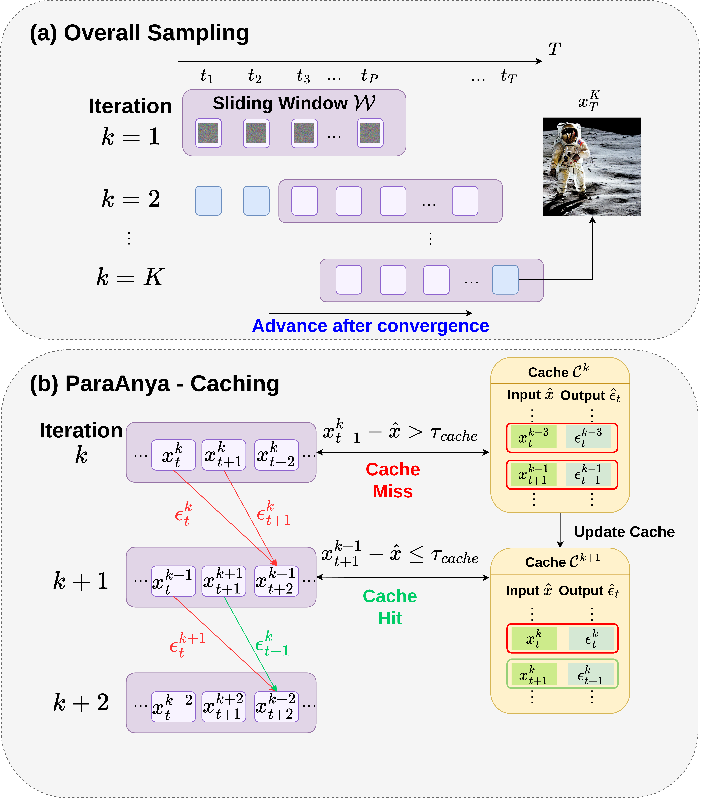

# ParaAnya

> **Note:** This repository is the official implementation for the paper *"ParaAnya: Accelerating Parallel Diffusion Sampling With Adaptive Output Caching"*. **The full source code will be released here upon acceptance to ICASSP 2027.**

## Overview
In this work, we propose **ParaAnya**, a caching mechanism that can be applied to various Parallel-in-Time (PinT) methods. 

ParaAnya stores an input-output pair for each timestep and directly reuses the cached output when the current input latent remains sufficiently close to the cached input. Only when the latent changes beyond a predefined threshold is a new network evaluation performed and the cache updated. By avoiding redundant network evaluations, ParaAnya substantially reduces computation and further improves the speedup of existing PinT diffusion samplers.

## Results

The comparisons below showcase the outputs of different PinT diffusion samplers with and without the integration of the ParaAnya plugin. 

As demonstrated, the visual differences are minimal, yet our approach maintains a significant computational speedup, proving the efficacy and reliability of the ParaAnya plugin.

